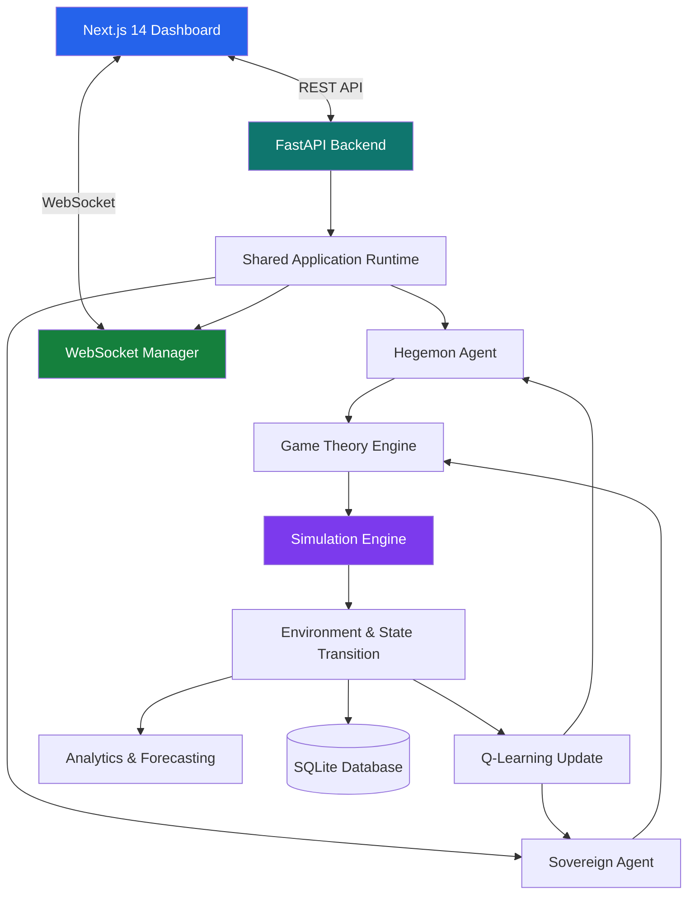
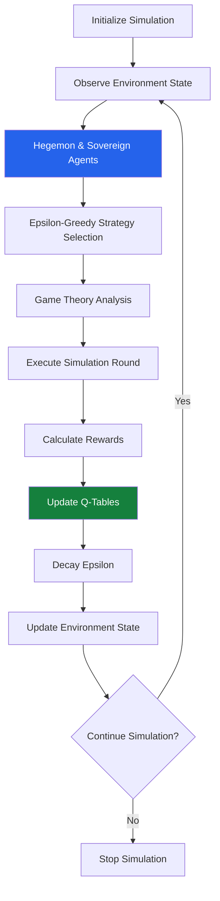
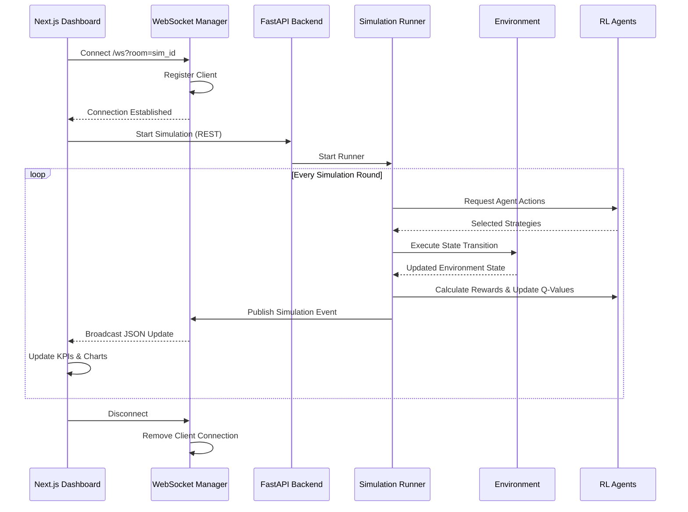
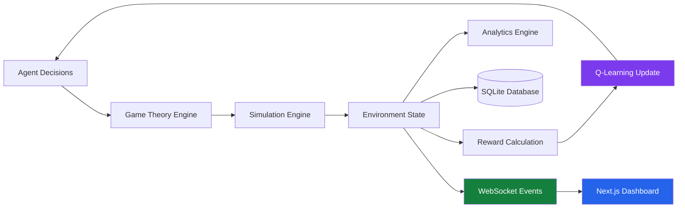

# 🌍 Strategic AI Nexus
### Real-Time Geopolitical Simulation with Reinforcement Learning Agents

Strategic AI Nexus is a modular multi-agent geopolitical simulation platform combining Reinforcement Learning, Game Theory, and real-time analytics to model strategic interactions between competing global powers.

The platform features adaptive AI agents, dynamic environment modeling, Nash equilibrium analysis, predictive analytics, and a real-time dashboard powered by FastAPI and WebSocket communication.

---

## ✨ Key Features

- 🧠 **Reinforcement Learning:** Custom Q-learning agents with epsilon-greedy exploration.
- 🎮 **Game Theory Engine:** Nash equilibrium analysis, payoff matrices, and mixed-strategy solving.
- 🌍 **Multi-Agent Simulation:** Hegemon and Sovereign agents with independent strategic doctrines.
- ⚡ **Real-Time Communication:** WebSocket-based live simulation updates.
- 📊 **Interactive Dashboard:** Live KPIs, agent intelligence, and geopolitical visualizations.
- 📈 **Predictive Analytics:** Linear-trend forecasting with confidence bands.
- 🔄 **Scenario Management:** Configurable simulation scenarios and lifecycle controls.
- 🎯 **Agent Telemetry:** Q-values, rewards, and learning progress metrics.
- 💾 **Data Persistence:** SQLite with SQLAlchemy ORM.

---

## 🛠️ Technology Stack

| Component | Technology |
|---|---|
| Backend | Python, FastAPI |
| AI / ML | Custom Q-Learning, NumPy |
| Game Theory | Nash Equilibrium, SciPy |
| Frontend | Next.js 14, TypeScript |
| Styling | Tailwind CSS |
| Real-Time | WebSocket |
| Database | SQLite, SQLAlchemy |
| Visualization | Recharts |
| API | REST API |

---

# 🏗️ System Architecture

Strategic AI Nexus follows a modular, event-driven architecture. The backend coordinates agent decisions, simulation execution, learning updates, analytics, and real-time communication.

## 1. High-Level System Architecture



### Architecture Components

| Layer | Responsibility |
|---|---|
| Frontend | Dashboard and visualization |
| API Layer | REST endpoints and WebSocket routes |
| Runtime | Centralized simulation lifecycle |
| Agent Layer | Independent reinforcement learning agents |
| Game Theory | Strategic interaction and equilibrium analysis |
| Simulation | Round execution and state transitions |
| Analytics | Forecasting and performance analysis |
| Database | Simulation data persistence |
| WebSocket | Real-time event broadcasting |

---

## 2. Reinforcement Learning Workflow

Both agents interact with the simulation environment through a continuous learning loop.



### Learning Process

1. Agents observe the current environment state.
2. Each agent selects a strategy using an epsilon-greedy policy.
3. The Game Theory Engine evaluates strategic interactions.
4. The Simulation Engine processes the selected actions.
5. Rewards are calculated based on the resulting state.
6. Q-values are updated using the learning algorithm.
7. Epsilon gradually decreases to balance exploration and exploitation.

---

## 3. Real-Time WebSocket Architecture

The platform uses persistent WebSocket connections to deliver live simulation events from the backend to connected dashboard clients.

Unlike traditional HTTP polling, WebSocket allows the backend to push updates directly to connected clients.



### WebSocket Communication Process

- **Connection:** Frontend establishes a persistent WebSocket connection.
- **Room Management:** Clients are associated with their respective simulation IDs.
- **Event Generation:** Simulation rounds generate updated state information.
- **Broadcasting:** WebSocket Manager distributes events to connected clients.
- **Visualization:** Frontend updates KPIs, charts, and agent telemetry.
- **Connection Management:** Heartbeat and disconnect handling help maintain connection reliability.

### Example Simulation Event

```json
{
  "event": "simulation_update",
  "simulation_id": "simulation_01",
  "round": 25,
  "state": {
    "economy": 76.5,
    "tension": 42.8,
    "stability": 68.2
  },
  "agents": {
    "hegemon": {
      "reward": 12.5,
      "epsilon": 0.15
    },
    "sovereign": {
      "reward": 15.2,
      "epsilon": 0.12
    }
  }
}
```

*Note: This is an illustrative JSON payload. Actual event fields depend on the backend implementation.*

---

## 4. Simulation Data Flow

This diagram illustrates how agent decisions, simulation processing, learning feedback, analytics, and dashboard communication interact.



---

# 🤖 Multi-Agent System

## Hegemon Agent

Represents a dominant geopolitical power operating through different strategic doctrines.

| Strategy | Name | Description |
|---|---|---|
| H1 | Expansionist | Pursues strategic expansion |
| H2 | Stabilizer | Maintains the status quo |
| H3 | Disruptor | Introduces strategic uncertainty |
| H4 | Dominator | Pursues overwhelming influence |

## Sovereign Agent

Represents sovereign powers pursuing resilience, autonomy, and strategic independence.

| Strategy | Name | Description |
|---|---|---|
| S1 | Diplomatic | Alliance building and negotiation |
| S2 | Resilient | Defense and institutional resilience |
| S3 | Assertive | Proactive strategic responses |
| S4 | Adaptive | Flexible strategy adaptation |

---

# 📊 Dashboard Features

| Component | Description |
|---|---|
| KPI Strip | Economy, tension, and stability metrics |
| Power Balance | Comparative agent influence |
| World Map | Geopolitical visualization |
| Agent Intelligence | RL telemetry and Q-value trends |
| Forecast Panel | Trend-based predictions |
| Conflict Tracker | Conflict monitoring |
| Military Overview | Strategic readiness indicators |
| Diplomatic Relations | Alliance and tension visualization |

---

# 📁 Project Structure

```text
strategic-ai-nexus/
│
├── backend/
│   ├── app/
│   │   ├── agents/
│   │   │   ├── base_agent.py
│   │   │   ├── hegemon_agent.py
│   │   │   └── sovereign_agent.py
│   │   │
│   │   ├── game_theory/
│   │   │   ├── equilibrium.py
│   │   │   ├── mixed_strategy.py
│   │   │   └── payoff_matrix.py
│   │   │
│   │   ├── simulation/
│   │   │   ├── engine.py
│   │   │   ├── runner.py
│   │   │   └── scenarios.py
│   │   │
│   │   ├── environment/
│   │   │   ├── environment.py
│   │   │   ├── state.py
│   │   │   └── transition.py
│   │   │
│   │   ├── realtime/
│   │   │   └── websocket.py
│   │   │
│   │   ├── analytics/
│   │   │   └── forecast.py
│   │   │
│   │   ├── api/
│   │   │   ├── routes/
│   │   │   │   ├── simulation.py
│   │   │   │   ├── state.py
│   │   │   │   ├── analytics.py
│   │   │   │   └── websocket.py
│   │   │   └── websocket.py
│   │   │
│   │   ├── core/
│   │   │   └── runtime.py
│   │   │
│   │   ├── database/
│   │   │   ├── models.py
│   │   │   ├── crud.py
│   │   │   └── session.py
│   │   │
│   │   └── utils/
│   │       ├── config.py
│   │       └── logger.py
│   │
│   ├── requirements.txt
│   ├── Dockerfile
│   └── run.py
│
└── frontend/
    ├── app/
    │   ├── components/
    │   │   └── Dashboard/
    │   │       ├── Dashboard.tsx
    │   │       ├── Sidebar.tsx
    │   │       ├── KpiStrip.tsx
    │   │       ├── PowerBalance.tsx
    │   │       ├── WorldMap.tsx
    │   │       ├── AgentIntelligence.tsx
    │   │       ├── ForecastPanel.tsx
    │   │       └── MilitaryOverview.tsx
    │   │
    │   ├── hooks/
    │   │   ├── useSimulation.ts
    │   │   └── useWebSocket.ts
    │   │
    │   └── types/
    │       └── index.ts
    │
    ├── package.json
    ├── tailwind.config.js
    └── tsconfig.json
```

---

# 🚀 Getting Started

## Prerequisites

- Python 3.9+
- Node.js 18+
- npm
- Git

## 1. Clone Repository

```bash
git clone https://github.com/nh30073007/Geo_Heartbeat.git

cd Geo_Heartbeat
```

## 2. Backend Setup

```bash
cd backend

python -m venv venv
```

**Windows:**

```bash
venv\Scripts\activate
```

**Linux / macOS:**

```bash
source venv/bin/activate
```

Install dependencies:

```bash
pip install -r requirements.txt
```

Configure environment:

```bash
copy .env.example .env
```

Start backend:

```bash
python run.py
```

Backend:

`http://localhost:8000`

API Documentation:

`http://localhost:8000/docs`

## 3. Frontend Setup

Open a new terminal:

```bash
cd frontend

npm install
```

Configure environment:

```bash
copy .env.example .env.local
```

Start development server:

```bash
npm run dev
```

Frontend:

`http://localhost:3000`

---

# 🔬 API Endpoints

## Simulation Management

| Method | Endpoint | Description |
|---|---|---|
| POST | `/api/simulation/create` | Create simulation |
| POST | `/api/simulation/start/{sim_id}` | Start simulation |
| POST | `/api/simulation/pause/{sim_id}` | Pause simulation |
| POST | `/api/simulation/resume/{sim_id}` | Resume simulation |
| POST | `/api/simulation/stop/{sim_id}` | Stop simulation |

## State & Analytics

| Method | Endpoint | Description |
|---|---|---|
| GET | `/api/state/current/{sim_id}` | Current simulation state |
| GET | `/api/state/history/{sim_id}?limit=120` | Historical states |
| GET | `/api/analytics/forecast/{sim_id}?horizon=8` | Trend forecasting |
| GET | `/api/analytics/performance/{sim_id}` | Performance metrics |

## WebSocket

```text
ws://localhost:8000/ws?room={sim_id}
```

---

# 📈 Core Simulation Metrics

| Metric | Range | Description |
|---|---|---|
| Economy | 0–100 | Economic strength |
| Tension | 0–100 | Geopolitical tension |
| Stability | 0–100 | Overall system stability |

---

# 🧪 Technical Highlights

- Custom reinforcement learning implementation.
- Independent multi-agent strategy selection.
- Adaptive payoff matrix calculations.
- Nash equilibrium analysis.
- Centralized simulation runtime.
- Asynchronous FastAPI architecture.
- WebSocket-based real-time event delivery.
- Historical state tracking.
- Trend-based forecasting.
- Modular backend and frontend separation.

---

# 🔮 Future Development

- Advanced Deep Reinforcement Learning algorithms.
- Multi-agent actor-critic architectures.
- LSTM and Transformer-based forecasting.
- Expanded geopolitical scenario generation.
- Advanced simulation experimentation tools.
- Distributed simulation execution.
- Enhanced real-time analytics.

---

# 🤝 Contributing

Contributions, suggestions, and improvements are welcome.

1. Fork the repository.
2. Create a feature branch.
3. Commit your changes.
4. Push your branch.
5. Open a Pull Request.

---

# 📄 License

This project is licensed under the MIT License.

---

**Built with Python, Reinforcement Learning, Game Theory, and Real-Time AI Simulation.**

*Strategic AI Nexus — Exploring adaptive intelligence in complex geopolitical systems.*